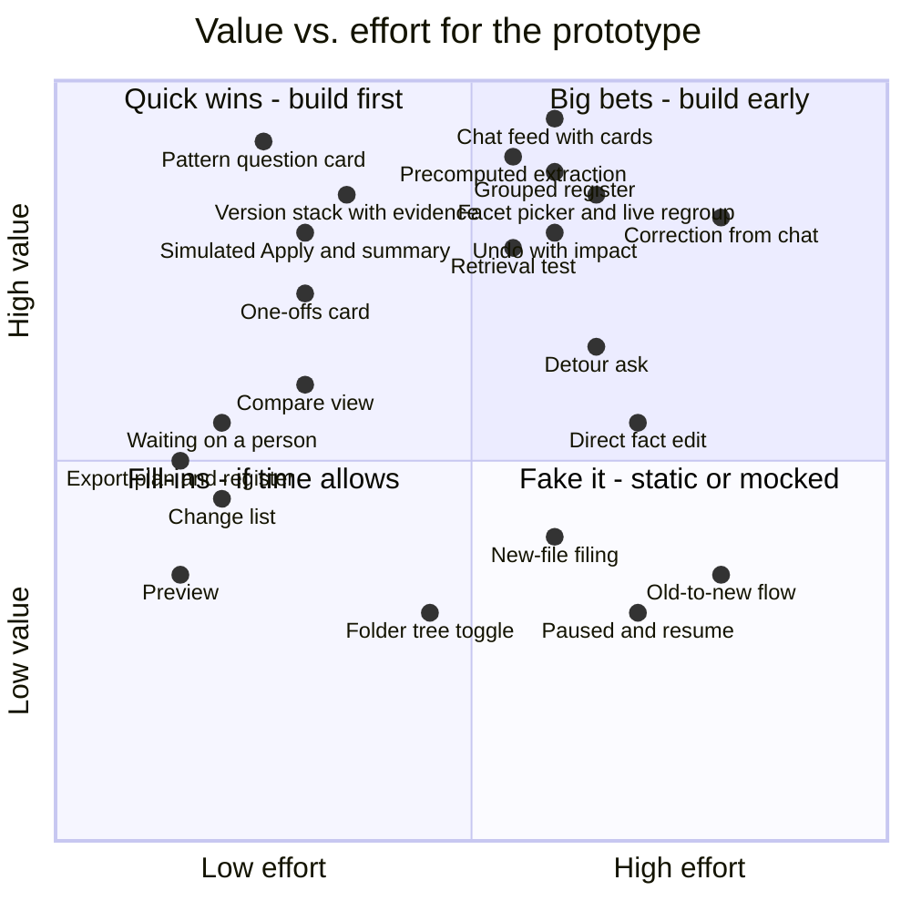

# Priority matrix: value vs. effort

The plan is to build everything in some form, but the matrix sets the order and how real each piece needs to be. Scores are my estimates on a 1–10 scale. Value means how much the piece shows Wordsmith's criteria (human/AI split, conversation, handling ambiguity). Effort means build time in the 3–5 hour box.

| Piece | Value | Effort | Quadrant | How real in the prototype |
| --- | --- | --- | --- | --- |
| Pattern question card (A/B + default) | 9 | 3 | Quick win | Real |
| Version stack with evidence | 8.5 | 3.5 | Quick win | Real |
| Simulated Apply + summary | 8 | 3 | Quick win | Real (simulated) |
| One-offs card | 7 | 3 | Quick win | Real |
| Compare view | 6 | 3 | Quick win | Real for Acme; static elsewhere |
| Waiting on a person | 5.5 | 2 | Quick win | Real (drafted question, state) |
| Export plan + register | 5 | 1.5 | Quick win | Real (CSV download) |
| Change list | 4.5 | 2 | Fill-in | Real |
| Preview | 3.5 | 1.5 | Fill-in | Excerpt + file details only |
| Chat feed with cards | 9.5 | 6 | Big bet | Real: the spine of the demo |
| Precomputed extraction (facts layer) | 9 | 5.5 | Big bet | Real, run ahead of time |
| Grouped register | 8.5 | 6 | Big bet | Real |
| Facet picker + live regroup | 8.5 | 6.5 | Big bet | Real |
| Undo with impact | 8 | 6 | Big bet | Real for cards; impact text precomputed |
| Retrieval test | 8 | 5.5 | Big bet | Real (LLM over the register) |
| Correction from chat | 8 | 8 | Big bet | Real for the scripted demo correction; LLM for others if time allows |
| Detour ask | 6.5 | 6.5 | Big bet | Real (LLM over excerpts) |
| Direct fact edit | 5.5 | 7 | Fake it | One editable field (counterparty) |
| New-file filing | 4 | 6 | Fake it | Explained with one mocked card |
| Folder tree toggle | 3 | 4.5 | Fill-in | Static render of the tree |
| Paused + resume | 3 | 7 | Fake it | One mocked resume card |
| Old-to-new flow | 3.5 | 8 | Fake it | Counts in the playback card instead |

## How it turned out

The matrix was the plan before building. In the build:

- **Built as planned:** pattern question cards, version stack with evidence, simulated Apply and summary, chat feed with cards, precomputed extraction, grouped register, retrieval test (a live model over the register), detour ask (from any row).
- **Changed:** Apply happens on each card as it's answered, not once at the end. The facet picker became two cards (top level, then second level) with hover previews. One-offs are one card each, not one card with "accept all". Direct fact edit went further than planned: every field is editable in the table and the side sheet.
- **Not built:** correction from chat, waiting on a person, compare view, export, change list as its own view, folder tree toggle, pause and resume, new-file filing, old-to-new flow.

## Suggested build order

1. **Foundations:** precomputed extraction, chat feed with cards, grouped register. Everything else sits on these.
2. **Quick wins:** pattern question, version stack, one-offs, simulated Apply + summary, export.
3. **Big bets:** facet picker + live regroup, undo with impact, retrieval test, detour ask, correction from chat.
4. **Fill-ins and fakes:** compare, waiting on a person, change list, preview, tree toggle, then mocked cards for new-file filing and resume.
