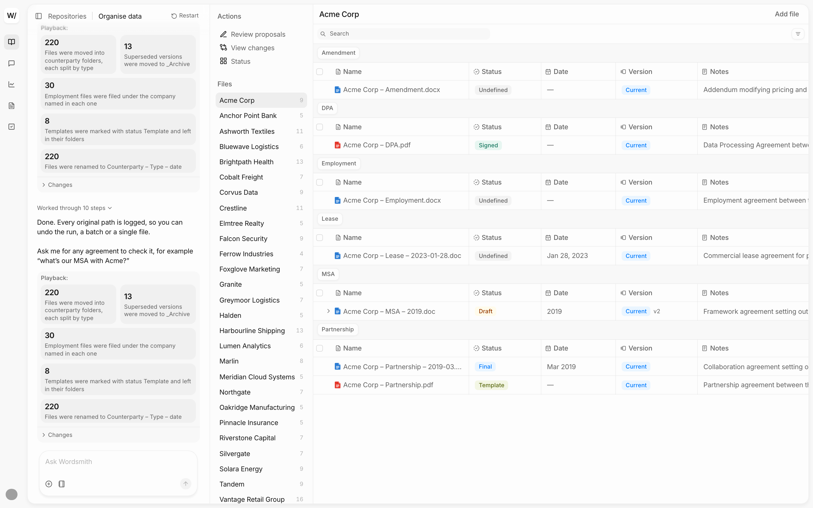

# Wordsmith take-home: organising a contract repository through chat

A chat-first assistant that cleans up a messy contract repository with a lawyer, not for them. It reads all 220 files and proposes how to file them. The user settles about 13 decisions, each a card with real example files and a recommended answer. The table beside the chat updates as each decision is applied.

The goal isn't tidy folders. It's that when anyone, a person or an AI agent, asks "what did we sign with Acme?", they get the in-force document, or an honest "not sure".



## What's in this repo

| File | What it covers |
| --- | --- |
| [01 Design brief](01-design-brief.md) | The problem, who it's for, principles, scope and success criteria |
| [02 Data audit](02-data-audit.md) | What the 220 files actually contain: version chains, contradictions, unknowns |
| [03 Assumptions](03-assumptions.md) | Every assumption the design rests on, and what depends on it |
| [04 AI principles](04-ai-principles.md) | When the assistant acts, proposes or asks; how it explains itself; the flow map and failure points |
| [05 Design decisions](05-design-decisions.md) | The tensions and the 16 decisions, with what the build changed |
| [06 Priority matrix](06-priority-matrix.md) | Value vs. effort for each piece, and how it turned out |
| [07 Screens and states](07-screens-and-states.md) | Every screen, card and state, and which were built |
| [prototype/](prototype) | The working prototype (React, TypeScript, Vite, Tailwind) |
| [backup/](backup) | Working files: ideation, the convention simulation and its script, charts |

## Running the prototype

You need Node 20 or later.

```bash
cd prototype
npm install
npm run dev
```

Then open the local address Vite prints (usually http://localhost:5173).

- **The scripted flow works on its own.** Start with "Organise my documents" and answer each card.
- **To jump to the end,** open `/?state=end`. It shows the repository after every recommended answer has been applied.
- **Typed questions use a live model** through the Cursor SDK. To turn them on, sign in once:

  ```bash
  npm run cursor-login
  ```

  Without it, the cards still work; typed questions reply with a prompt to sign in. Spending is capped at 200,000 tokens per server run; set `ASK_TOKEN_BUDGET` to change it.

## How the data is built

The cards and the register are precomputed from the take-home dataset, so the demo is fast and repeatable. `prototype/scripts/build-data.py` reads the dataset CSV and `backup/convention-simulation.md`, sets a version role on every file, and writes `prototype/src/generated.json`:

```bash
cd prototype
python3 scripts/build-data.py "path/to/contract repository dataset.csv"
```
