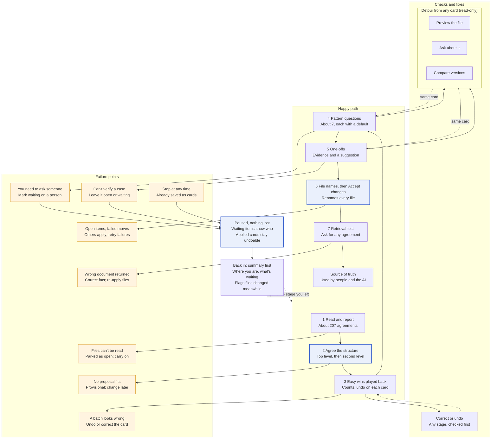
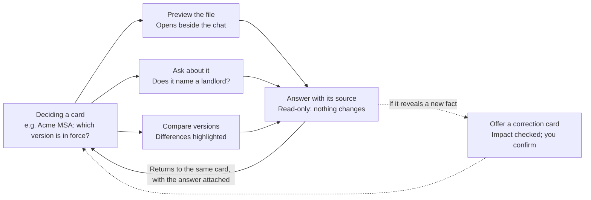

# Contract Clean-Up — AI Principles & Flow Map

@Jinny Lee

The assistant does the reading and proposes at every stage; nothing sticks until the user confirms it, and every explanation sits on the decision it explains.

> **Updated after the build.** These principles were written before the prototype and still hold. What changed is the commitment model: each decision is applied when the user presses Apply on its card, and stays undoable there. Only renaming waits for the end, where **Accept changes** renames the files after a "Ready to apply" summary. The diagrams below are updated to match. Also not built: batch cards for easy wins, one "accept all" card for one-offs, correction cards, waiting on a person, compare, and pause and resume. The direct edit of any field in the table or side sheet *was* built.

## Autonomy: who acts, and when

**How much the assistant does on its own depends on two things: how sure it is, and how much a mistake would cost if the wrong document were retrieved.** Being sure is never enough on its own to act silently: every action is at least played back.

| Level | The assistant… | Used when | Examples |
| --- | --- | --- | --- |
| **Acts, then tells** | Decides and plays it back as counts the user can check in the table and undo | Sure, and a mistake is cheap or obvious | Formatting; unambiguous facts; single-file agreements; clean chains like Pinnacle's MSA |
| **Proposes a pattern** | Offers A or B with real examples and a recommended default | Sure of the pattern, but the choice is a policy | Copies and `(1)` files; employment files; orphan SOWs; folders that are instructions |
| **Proposes a one-off** | Suggests an answer with its evidence; waits | Unsure, and a mistake would mislead retrieval | Acme's MSA with nothing labelled signed; self-contradicting filenames |
| **Asks openly** | States what it can't tell and why; offers "leave open" | No reasonable default exists | Four landlords for one Leith property; files with no counterparty |
| **Never** | Does not do it, even if asked in passing | Irreversible or beyond the evidence | Deleting; calling a file signed; merging look-alikes without asking; widening a correction's scope alone |

The user always owns three things outright: **the convention, applying each decision, and every undo**.

## Explanation: where and how the assistant explains itself

**Every explanation lives on the decision it explains, in layers: one line by default, with the evidence one click away.** Users shouldn't have to scroll back through the chat or open a log to learn why something happened.

| Where | What it explains | Depth |
| --- | --- | --- |
| **Opening report** | What it found and how sure it is overall | Counts only: "191 agreements, 19 with several versions, 12 I can't identify" (the build reports about 207 agreements and how the team files today) |
| **Playback** (easy wins and every applied card) | The rule it applied and how many files it covered | One line per change with a count; "Show in table" highlights the rows |
| **Pattern question** | Why this is a choice, and why it recommends one option | Real examples for each option; the recommendation's reason in one sentence |
| **One-off card** | The evidence for and against, per file | Filename, excerpt and folder side by side, with the conflict highlighted |
| **Register and side sheet** | Why each file is where it is | Click a row: its side sheet shows the original path, the excerpt and a note on why it's there, all editable |
| **Correction and undo cards** | What else the change affects | "Reopens 30 files · changes 2 later decisions" |
| **Retrieval answer** | Which file is in force, and why | The in-force file, the versions it beat, and any caveat |

Rules for explaining:

- **Lead with counts and consequences,** not process. "148 files renamed" beats "I analysed the naming patterns".
- **Name the source of each fact:** filename, excerpt or folder.
- **Explain assumptions after acting, at the moment they apply.** "I read `08-12-20` as 8 December, since your addresses are in the UK."
- **Explain restraint too.** "I kept Vantage's 5 partnerships separate: they cover different deals."

## Confirmation: what needs a yes, and how it's given

**Words carry intent; controls carry commitment.** The user can say anything in chat, but nothing they say is acted on until it appears as a card with an exact scope and they press its control.

| Moment | How the user gives it | Why this way |
| --- | --- | --- |
| Shaping the convention | Words, plus picking and ordering facets | Taste and intent; the examples redraw as they go |
| Confirming the convention | **Control:** "Use this convention" | It sets where every file goes |
| Pattern answer | **Control:** option A or B (or "leave open") | One exact choice across a whole group |
| One-offs | **Control:** accept all, or accept with exceptions | Many small yeses in one gesture |
| Corrections | Words or a direct edit, then **control:** "Apply correction" | The assistant checks the impact first; the user confirms the exact scope |
| Undo | **Control** on the card | One right answer; nothing to interpret |
| Apply | **Control:** Apply on each card, then Accept changes at the end for renaming | Each decision changes the repository as it's made; names change once, last |

Rules for confirming:

- **Ask for confirmation only when there's something to weigh.** A self-contained undo happens at once; an undo that affects other decisions asks first.
- **Every question has a suggested answer,** so most replies are a single press.
- **Offer to widen the scope once, never assume it.** "4 other files match. Apply the same?"
- **No yes is implied by silence or by moving on.** Unanswered questions stay open and are listed at the playback.

## Uncertainty and honesty

**The assistant says only what the evidence supports, uses fixed words for how sure it is, and treats "I don't know" as a valid result.**

| Word on screen | Means | Example |
| --- | --- | --- |
| **Labelled signed** | A filename or folder says signed; nothing proves it | Pinnacle MSA `signed-19.01.2018` |
| **Assumed** | The assistant filled a gap with a default the user accepted | Acme's 2019 FINAL(2) as in force |
| **Conflicting** | Sources disagree, and the assistant shows both | `signed_…_unsigned`; four landlords for one property |
| **Open** | Not resolved; the gap is stated | "No counterparty found in filename or excerpt" |

Rules:

- **Use words, not percentages.** "87% confident" invites false precision; the four words above each lead to a clear action.
- **Never guess identity.** A file with no counterparty stays open rather than being matched to the likeliest one.
- **Keep the caveat attached.** An "assumed" or "open" state travels with the agreement into the register and into every retrieval answer.
- **Count the unknowns out loud** at the start and at the playback: "12 I can't identify", "3 still open".

## The complete flow

The happy path runs down the middle. Checks and fixes on the left always return to the card you were on. Failures on the right either recover in place or collect in one paused state that resumes where you left off. The sections below zoom into each part.



## Flow map

The assistant starts almost every exchange with a proposal. Every decision is a commitment the user makes with a control, Apply on its card, and each one stays undoable. Renaming is the last commitment: Accept changes. *(Updated to the build; the original map had one Apply at the end.)*

```mermaid
sequenceDiagram
    actor U as You
    participant A as Assistant
    Note over U,A: 1 Read
    U->>A: Shares the repository (220 files, 23 folders)
    A-->>U: Reports: about 207 agreements, 28 counterparties, how the team files today
    Note over U,A: 2 Structure
    A->>U: Top level, then second level, each with a recommendation and a hover preview
    U->>A: [Control] Apply (folders redraw)
    Note over U,A: 3 Easy wins
    A-->>U: Single-file agreements and labelled-signed chains settle as the structure lands, played back as counts
    Note over U,A: 4 Patterns
    A->>U: Dates, templates, what counts as current, unsigned chains, employment, missing status
    U->>A: [Control] Apply an option; one answer settles the group
    Note over U,A: 5 One-offs
    A->>U: Solara, Vantage, unidentified files, contradictory names: one card each, with evidence
    U->>A: [Control] Apply, or Skip
    Note over U,A: 6 Names
    A->>U: File-name pattern, then "Ready to apply": everything that has happened
    U->>A: [Control] Accept changes (files renamed)
    Note over U,A: 7 Test
    U->>A: "Show me the Pinnacle MSA"
    A-->>U: In-force file, with a caveat if open
    Note over U,A: Any stage
    U->>A: Presses Undo changes on a card, or edits a field in the table or side sheet
    A-->>U: The register updates; nothing is deleted
```

## Detours: checking before deciding

**The user can step out of the organising flow at any card to look at a document, ask about it or compare versions, then come back to the same card without losing their place.** Deciding often needs a look first, especially for one-offs.



| Detour | What the user does | What the assistant does |
| --- | --- | --- |
| **Preview** | Opens a file from a card, the register or a version stack | Shows it beside the chat; the card stays pinned ("You were deciding: Acme MSA") |
| **Ask** | "Does the FINAL(2) have a signature block?" "Which of these names a landlord?" | Answers only from the documents, citing file and passage; questions are scoped to the card's files by default |
| **Compare** | Picks two versions in a stack | Shows the differences side by side (date, parties, status words, changed clauses) |

Rules for detours:

- **Questions are read-only.** Asking never changes a decision or a file.
- **The decision waits, pinned.** Returning lands on the same card, with the answer attached as evidence.
- **New facts become corrections, not quiet updates.** If an answer reveals something ("this lease names Ashworth as landlord"), the assistant offers a correction card with its impact checked.
- **"I don't know" still applies.** If the text can't answer, the assistant says so, and suggests marking the card as waiting on a person.

*Prototype limit:* the data has short excerpts, not full documents, so preview and questions run on excerpts and file details. Full-document questions are next-step work.

## Failure points and recovery

**Every failure ends in a saved, visible state the user can return to, never a dead end.** Because decisions apply as they're made, stopping mid-way leaves the repository partly organised, but every applied card can still be undone.

| Stage | What goes wrong | What happens |
| --- | --- | --- |
| 1 Read | Some files can't be read (poor scans, locked or corrupt files) | Reported and parked as open; the rest of the flow carries on |
| 2 Convention | None of the proposals fit, or you can't choose yet | Start from a provisional one; changing it later costs nothing |
| 3 Easy wins | A batch looks wrong: the rule caught the wrong files | Undo or correct the card; impact is checked before it lands |
| 4 Patterns | You need to ask someone: a policy call that isn't yours to make | Mark it waiting on a person; the assistant drafts the question → **Paused** |
| 5 One-offs | You can't verify a case: need the signed copy or a colleague | Leave it open or waiting; its files stay untouched → **Paused** |
| 6 Accept changes | Items still open, skipped or waiting, and you don't want to wait | Accept everything else; open items keep their current place |
| Any Apply | A file fails to move or rename: locked, name taken or no access | Listed on the card or the Apply summary; retry; each file moves or doesn't |
| 7 Test | The wrong document comes back | Correct the fact; only affected files are re-applied |
| Any time | You have to stop mid-way | Progress is already saved: every decision is already a card → **Paused** |

**Paused, nothing lost:** waiting items show who and what; applied decisions stay in place and stay undoable. **Back in:** a summary of where you are and what's still waiting, a flag on files changed since you left, then the flow rejoins the stage you left.

Three rules make this work:

- **Progress is the decision log.** Every answer is already a card, so stopping loses nothing and there's no separate "save".
- **"Waiting on a person" is a fourth state,** next to resolved, resolved by you and open. It records who and what, and the assistant drafts the question with the evidence attached; the user sends it themselves.
- **Nothing waiting blocks the rest.** Each decision applies on its own; open, skipped and waiting items keep their current place until they're resolved.

The prototype still assumes one sitting. The paused path is design intent and isn't built; Skip on each card is the only part of it in the prototype.

### More failure points to design for

Beyond the stage-by-stage failures above, the riskier ones are quiet: the model is wrong with confidence, or the user agrees without looking.

| Area | Failure | Example or trigger | How it recovers |
| --- | --- | --- | --- |
| **Model** | Wrong, but sure of itself: an "easy win" that isn't | A licence filed under the wrong counterparty | The playback includes a random sample of 5 easy wins to spot-check; any fix offers to generalise |
| **Model** | Two versions both claim to be signed | Marlin lease: `signed_Lease_29.07.2025` and `Property Lease_executed_2026` | Becomes a one-off, never an easy win; both shown side by side |
| **Model** | A chain is split, or two deals are merged | A date read the wrong way round reorders a chain | Version stack shows the order and why; the date assumption is stated on the card |
| **Model** | A fact with no source | A counterparty the model inferred but nothing states | Rule: no fact without cited evidence; otherwise it's open |
| **Model** | The model or API fails mid-flow | Timeout or rate limit during extraction | Extraction runs ahead and is cached; the conversation retries without losing cards |
| **Convention** | Two files map to the same new name | Three Marlin lease copies under one name | Suffix added automatically and flagged on the card |
| **Convention** | A chosen facet is missing for many files | Year picked as a folder level; 62 filenames have no date | The assistant warns before confirming and proposes an "Undated" group |
| **Convention** | Names the document system won't accept | `Halden & Co`, slashes, very long paths | Cleaned automatically; the change is shown in the examples |
| **User** | Accepting everything without reading | "Accept all" pressed in 2 seconds on 8 one-offs | Highest-risk items can't be bulk-accepted; each shows its evidence first |
| **User** | A new answer contradicts an earlier one without realising | "Keep copies" after confirming "copies are duplicates" | Impact check names the conflict: "This overrides your answer on copies (20 files)" |
| **User** | Question fatigue | Questions keep coming after decision 10 | A visible count ("3 of 7 patterns"); the assistant offers to leave the rest open |
| **People** | The colleague never replies | A "waiting on" question unanswered for weeks | Stays waiting, with its age shown; files untouched; a reminder on resume |
| **People** | Two people clean up at once | A colleague starts a second session on the same repository | One active clean-up per repository; the second person joins or waits |
| **Environment** | The repository changes during the session | Someone adds or renames a file | Rescan before each Apply and on resume; affected cards are flagged |
| **Environment** | Folders the user can't see | No access to the HR folder | Reported as "not visible to you", never as "missing" |
| **Environment** | Files under a legal hold or retention rule | A file in active litigation | Held files are never moved; shown as locked, with the reason |
| **After the run** | Links to old paths break | Emails, the CRM or other documents link to the old location | Old-to-new map kept; redirects or shortcuts where the system supports them |
| **After the run** | Undo after people have started using the new structure | Undoing a batch a week later | The undo card shows what has happened since ("12 files opened since Apply") before it runs |
| **After the run** | The AI still answers from the old index | Retrieval returns an old path | Re-index straight after Apply; the retrieval test runs on the new index |
| **After the run** | A signed copy turns up later | Someone finds the executed Acme MSA in their inbox | Adding it to the agreement supersedes the "assumed" version, with a card to confirm |
